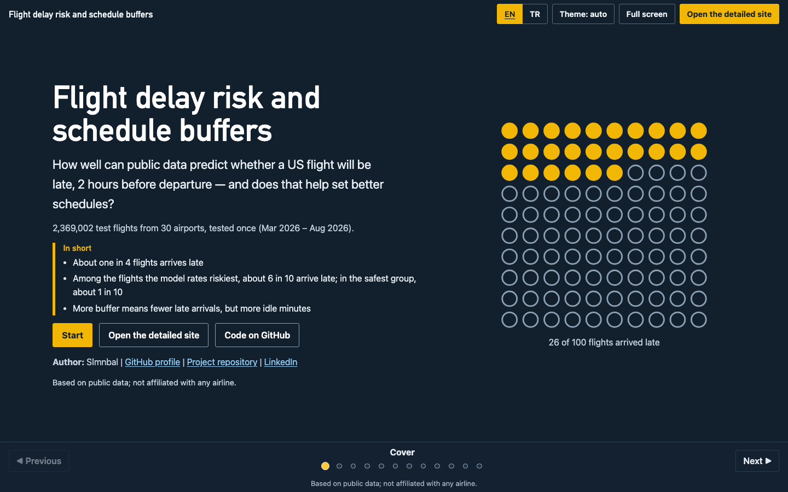
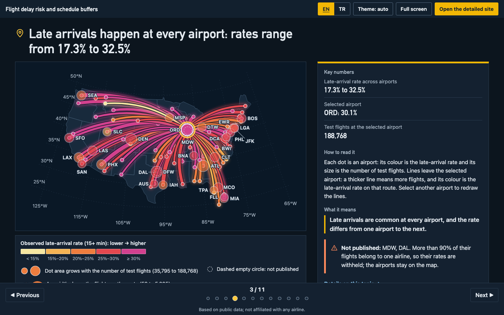
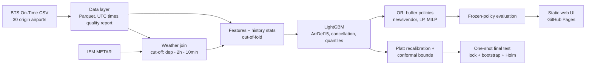
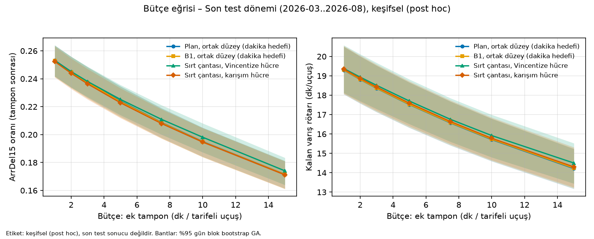

# Flight delay risk and schedule buffers (US domestic, BTS data)

[](https://github.com/Slmnbal/flight-delay-forecasting/actions/workflows/ci.yml)
[](https://slmnbal.github.io/flight-delay-forecasting/sunum/)

[](LICENSE)

**Presentation (start here):** <https://slmnbal.github.io/flight-delay-forecasting/sunum/> — an 11-slide executive walkthrough with simple charts (arrow keys to navigate; Turkish: [`?lang=tr`](https://slmnbal.github.io/flight-delay-forecasting/sunum/?lang=tr)).  
**Detailed site:** <https://slmnbal.github.io/flight-delay-forecasting/> — results, interactive map and route tables, buffer optimisation, methods and glossary.

> Based on public data; not affiliated with any airline.

[](https://slmnbal.github.io/flight-delay-forecasting/sunum/)

[](https://slmnbal.github.io/flight-delay-forecasting/sunum/#3)

**Problem.** Given only the schedule, past statistics and weather observed 2 hours before departure, how well can we
predict whether a US domestic flight arrives 15+ minutes late (ArrDel15), how large the arrival delay will be
(P50 / P80 / P95), and does that information help a planner choose better block-time buffers?

**What was done.** Public BTS On-Time Performance data for 30 US airports (36 months, 2023-09 to 2026-08, 13.7 M
scheduled departures) joined with IEM METAR weather; LightGBM classifiers and quantile models; probability
recalibration and conformal prediction bounds; a pre-registered, one-shot evaluation on the last 6 months
(2026-03 to 2026-08) against a hard-to-beat baseline (B1: route x hour-block history); and an operations-research
(OR) extension that turns the quantiles into schedule buffer policies (newsvendor, knapsack, LP / MILP in Pyomo + HiGHS).

Status (2026-11-23): modelling and OR results are final; a bilingual (Turkish/English) static web interface is in `deliverables/src/web/` and live on GitHub Pages.

## Headline results (final test, 2026-03..08, 184 days, 2,315,618 completed flights)

All differences are **model minus baseline B1** on the same flights, with 95% day-block bootstrap intervals
(B = 1000). Source for every number: [`son-test-ozet.md`](experiments/son-test/son-test-20261122T105048Z/son-test-ozet.md)
(Turkish tables; same numbers).

| # | Result | Model | B1 | Difference vs B1 [95% CI] |
|---|---|---|---|---|
| 1 | ArrDel15 ranking, ROC-AUC (T-2h model; prevalence 0.2626) | 0.7120 | 0.6564 | +0.0556 [+0.0499; +0.0612] |
| 2 | ArrDel15 ranking, PR-AUC (precision-recall AUC) | 0.4767 | 0.3754 | +0.1013 [+0.0915; +0.1105] |
| 3 | ArrDel15 Brier skill score (BSS), monthly-rolling Platt calibration | - | - | +0.0625 [+0.0541; +0.0712] |
| 4 | Arrival-delay quantiles, schedule-only "plan" model, pinball loss (min) | - | - | P50 -0.2315 [-0.2586; -0.2016]; P80 -0.2168 [-0.2704; -0.1637]; P95 -0.1066 [-0.1422; -0.0713] |
| 5 | Where the ROC-AUC gain comes from (same flights) | - | - | schedule + history model vs B1: +0.0193 [+0.0152; +0.0234]; T-2h weather on top of it: +0.0363 [+0.0315; +0.0410] |

Calibration after monthly-rolling Platt recalibration: calibration-in-the-large (CITL) -0.0025, slope 1.002. Without
recalibration the raw model under-predicts (CITL -0.0302, slope 0.940). BSS compares Brier scores with B1: positive means
better than B1.

**What did not work (criteria that failed, reported as they came out):**

- **K5, conformal coverage by airport-month: failed.** Overall coverage of the P80 / P95 upper bounds was inside the
  pre-registered band (0.7877 / 0.9447), but only 68.9% of Origin x month segments (n >= 500) had P80 coverage within
  +/-0.05 of target (required: 80%). Coverage was low in June and July (P80: 0.7547, 0.7560).
- **K6, cancellation: failed.** The schedule-only cancellation model has no detectable gain over B1 (PR-AUC difference
  -0.0005 [-0.0048; +0.0039]). Cancellation risk is not predictable from schedule and history here.
- **OR main finding: at an equal buffer budget (minutes per flight) the plan model is about as good as B1**
  (difference in post-buffer ArrDel15 at most +0.0004, 95% intervals include or just touch 0). The value of the model is mainly in the
  **T-2h operational prediction**, not in schedule buffers. See [`docs/optimization.md`](deliverables/docs/optimization.md).

Full acceptance table (K1-K7): [`docs/model-card.md`](deliverables/docs/model-card.md#evaluation-results). K1-K4 and K7 passed.

## How to trust (and not trust) these numbers

- **Time-ordered split, no random shuffling.** Train 2023-09..2025-08, early stopping 2025-09..12, calibration
  2026-01..02, final test 2026-03..08. Details: [`docs/methodology.md`](deliverables/docs/methodology.md).
- **Leakage controls.** A feature contract bars post-departure fields and delay-cause minutes; weather is cut at
  scheduled departure - 2 h - 10 min; row-level time tests; permutation + time-travel review of the locked models found
  no suspicion (caveat: reviews used a 26-day validation sample).
- **Pre-registration and one-shot test.** Rules, metrics and acceptance criteria were written before the test
  ([`son-test-on-kayit.md`](experiments/son-test-on-kayit.md), Turkish); a lock file blocks a second run; nothing was
  tuned on the test. Three documented deviations from the original plan are listed in the methodology page.
- **Statistics.** Day-block bootstrap (flights of one day are dependent), paired differences, Holm correction over 7
  primary comparisons. Six of seven were significant; the seventh (cancellation) was not.
- **Not a claim about airlines.** No comparison with any airline's internal systems is made (no such data).
- **Optimization results rest on assumed costs** (see Assumptions). Test-period OR numbers from the solver extension are
  labelled *exploratory (post hoc), not a final-test result*.

## Limitations (short)

Full list: [`docs/model-card.md`](deliverables/docs/model-card.md#caveats-and-limitations).

- Public BTS labels are published with about a 2-month lag; the monthly-rolling recalibration and conformal windows assume labels
  are known after 1 day (an operator scenario). A secondary "public" scenario with a 2-month lag is reported; it fared worse on segment coverage (57.8% of segments for P80).
- Only reporting carriers' scheduled domestic flights; 30 origin airports; no aircraft rotation, crew or network effects.
- Delay quantiles are conditional on the flight being completed; cancellations and diversions are excluded from them.
- Model is 6-12 months stale at test time (trained once, on data up to 2025-08); the test period's ArrDel15 rate
  (0.2626) was higher than in the early-stopping period 2025-09..12 (0.2228).
- OR costs are assumed (rate grid), "1 minute of buffer = 1 minute less arrival delay" (assumption A1), no rotation/crew/network
  feedback; buffers are not validated operationally.
- Single-carrier cells: in the test period 16,882 of 24,765 route x hour-block x season cells are dominated (>90%) by one carrier;
  buffer suggestions are published only for 7,094 cells (n >= 50 and not carrier-dominated) to avoid carrier-level disclosure.

## Architecture



## Assumptions (stated up front)

1. **OR costs are assumptions.** Only the ratio c_u / c_o (cost of a late minute vs a wasted buffer minute) is chosen, on a grid
   (tau = c_u / (c_u + c_o) from 0.50 to 0.95); costs are weighted minutes, not money.
2. **A1:** 1 minute of added block time = 1 minute less arrival delay (the flight itself does not change, the model is not re-run).
3. No aircraft rotation, crew, slot or network effects. Delay chaining is ignored (likely understates the benefit; not verified).
4. Public BTS labels arrive ~2 months late; rolling windows assume 1 day. The "public" scenario is secondary.

## Repository layout (this folder)

| Path | Content |
|---|---|
| `src/flight_delay/data/` | download, layer building (UTC), METAR, weather join, quality checks, feature contract |
| `src/flight_delay/modeling/` | baselines, LightGBM, calibration, conformal, bootstrap, permutation review, final test and lock |
| `src/flight_delay/optimization/` | newsvendor, allocation, policies, Pyomo LP / MILP, plots |
| `src/flight_delay/mlops/` | reproducibility helpers, MLflow settings |
| `tests/unit/` | unit tests (613 passed in the last run) |
| `data/LAYER_SCHEMA.md`, `data/quality-report.md` | table schema and data quality report |
| `docs/` | model card, methodology, optimization, Turkish summary |

Experiment records (plans, final-test output, OR output; mostly Turkish) are in `../experiments/`. Raw data and Parquet files are
not versioned.

## Reproduce

Not tested in a clean environment yet. The commands below follow the code's command-line interfaces; run them from the
project root (`projects/havayolu-ds/` in the working tree) and check `--help` first. Several steps download data (BTS, IEM).

```bash
# Environment: Python 3.12 (3.12.13 used); key versions: pandas 3.1.1, lightgbm 4.7.0, scikit-learn 1.9.1,
# MAPIE 1.6.0, Pyomo 6.11.0, highspy 1.16.0, duckdb 2.0.0 (see deliverables/config/requirements-lock.txt)
python3.12 -m venv .venv && source .venv/bin/activate
pip install -e "deliverables[dev,modeling,optimization,query,geo,mlflow]"

# Tests
python -m pytest deliverables/tests/unit

# Data (network): BTS months into the Parquet layer, IEM METAR, join, quality report
python -m flight_delay.data.download_range --start 2023-09 --end 2026-08 --delete-raw
python -m flight_delay.data.download_iem --start 2023-09-01 --end 2026-08-31
python -m flight_delay.data.metar --raw-dir deliverables/data/raw/iem_asos
python -m flight_delay.data.weather_join --metar deliverables/data/layer/metar/metar.parquet
python -m flight_delay.data.quality

# Models, calibration, review (see run_models --help for contract plan/T2 and options)
python -m flight_delay.modeling.run_baselines
python -m flight_delay.modeling.run_models --contract plan
python -m flight_delay.modeling.run_models
python -m flight_delay.modeling.run_calibration --run-id <run-id>
python -m flight_delay.modeling.run_permutation --run-id <run-id>

# Final test: refuses to run twice (lock file). Needs the freeze manifest (final_lock).
python -m flight_delay.modeling.run_final_test --rehearsal --manifest <draft-manifest.json>
python -m flight_delay.modeling.run_final_test --final --manifest <manifest.json>

# OR
python -m flight_delay.optimization.run_buffer --dry-run
python -m flight_delay.optimization.run_buffer
python -m flight_delay.optimization.run_solver --dry-run
python -m flight_delay.optimization.run_solver
```

Exact reproduction of the reported numbers needs the same data months, the same model files and the freeze manifest from
`../experiments/`; full model training time was not measured in this document.

## Figure (OR, exploratory)



*Exploratory (post hoc), not a final-test result. Bands: 95% day-block bootstrap. Under assumption A1.*

## Data sources and licenses

| Source | Use | License / terms (status) |
|---|---|---|
| US DOT / BTS Reporting Carrier On-Time Performance | flights, delays, labels | US government work; data.gov records carry a public-domain label (partly verified; the BTS page's own license text could not be read) |
| Iowa Environmental Mesonet (IEM) ASOS / METAR archive | weather observations | public domain per IEM's own statement; attribution requested (verified) |
| OurAirports | airport coordinates, time zones (with manual overrides) | public-domain claim (partly verified; certificate error when reading the page) |

Source research: [`../research/veri-kaynaklari.md`](research/veri-kaynaklari.md) (Turkish). Raw data are not redistributed. Delay-cause minutes
in BTS data are the carrier's own report and are not used. No tail numbers or flight numbers are published.

## License

Code: [MIT License](LICENSE). Author: Slmnbal. Data sources keep their own terms (see above).

## Web interface

A static site (`deliverables/src/web/`, no build step, no external requests) reads precomputed JSON files produced by
`python -m flight_delay.modeling.run_interface_export`. The interface has a Turkish/English switch. Preview locally:
`cd deliverables/src/web && python -m http.server 8137`. Map outlines: Natural Earth (public domain).

Turkish summary: [`docs/README.tr.md`](deliverables/docs/README.tr.md).
