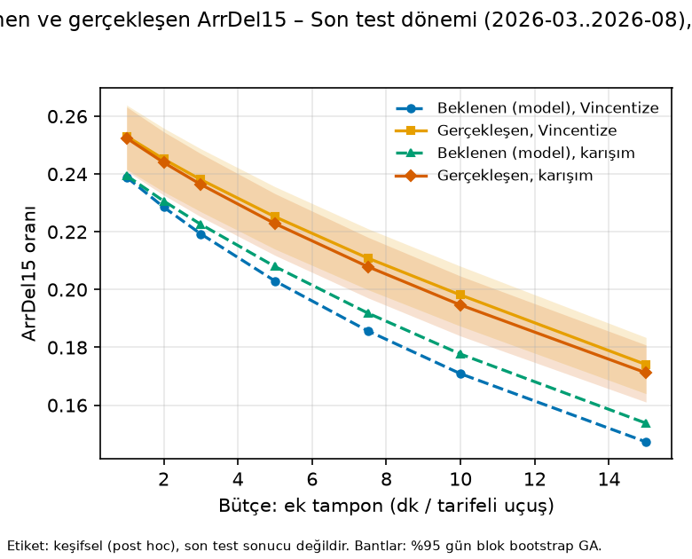

# Optimization: schedule block-time buffers from delay quantiles

> Based on public data; not affiliated with any airline.

Sources: formulation [`experiments/or-tampon-formulasyonu.md`](../../experiments/or-tampon-formulasyonu.md); primary OR run
[`tampon-ozet.md`](../../experiments/or/tampon-20261122T173803Z/tampon-ozet.md) (policies frozen **before** the test period was read);
knapsack review [`sirt-cantasi-incelemesi.md`](../../experiments/or/sirt-cantasi-incelemesi.md); solver extension
[`cozucu-ozet.md`](../../experiments/or/cozucu-20261122T181720Z/cozucu-ozet.md) (**exploratory, post hoc, not a final-test result**). All Turkish.
Costs are weighted minutes, not money.

## Decision and assumptions

A schedule planner chooses, months ahead, an extra buffer b >= 0 minutes for each cell (route x departure-hour block x season, 24,765 cells in the test period). Quantiles come from the
schedule-only `plan` model (no weather).

- **Costs are assumptions.** A late minute costs c_u, an unused buffer minute costs c_o; only the ratio matters, set through tau = c_u / (c_u + c_o) on a grid 0.50, 0.55, ..., 0.95
  (c_u / c_o from 1 to 19). Normalisation: c_u = tau, c_o = 1 - tau.
- **A1:** 1 minute of buffer = 1 minute less arrival delay; the flight is unchanged and the model is **not** re-run with the new block time.
- No rotation, crew, slot or network constraints; delay chaining ignored (likely understates the benefit; not verified). b >= 0 (schedules are not shortened).
- Quantile levels are limited to 0.10-0.95; tau > 0.95 is rejected, no tail is invented.
- The cell distribution is the level-wise average of the flights' quantiles (Vincentization), an approximation (see knapsack below).

**Newsvendor result.** With A1 the cost of a completed flight is minimised at b* = max(0, Q(tau)), the tau-quantile of the cell's arrival delay.

**Policies compared:** (i) no extra buffer; (ii) B1 cell quantile; (iii) plan model; (iv) plan + rolling conformal offset (operator scenario: needs labels up to 2 days old); (v) B1 + the same conformal step (fairness check);
(vi) plan at flight level (secondary). **Equal-budget comparison:** for a budget of beta extra minutes per scheduled flight, the minute-minimising allocation uses one common quantile level in all cells
(closed form from the KKT conditions); the plan and B1 are compared at the same total minutes.

## Results: frozen policies on the test period (2026-03..08)

Reported under the same rules as the primary run: policies and the aggregation choice were frozen before the test was read; nothing was tuned on it. Cost in weighted minutes per flight; 95% day-block bootstrap intervals in brackets.

| tau | No buffer | B1 | Plan | Plan minus B1 [95% CI] | Extra buffer, B1 / plan (min per flight) |
|---|---|---|---|---|---|
| 0.50 | 9.925 | 9.893 | 9.868 | -0.025 [-0.036; -0.013] | 0.57 / 1.01 |
| 0.60 | 11.910 | 11.570 | 11.553 | -0.017 [-0.040; +0.006] | 4.87 / 5.64 |
| 0.70 | 13.895 | 12.728 | 12.695 | -0.033 [-0.062; -0.001] | 11.58 / 12.74 |
| 0.80 (publication level) | 15.880 | 13.003 | 12.910 | -0.093 [-0.129; -0.054] | 19.28 / 20.88 |
| 0.90 | 17.865 | 11.088 | 11.025 | -0.062 [-0.095; -0.030] | 45.62 / 46.78 |
| 0.95 | 18.858 | 8.437 | 8.386 | -0.051 [-0.079; -0.026] | 80.80 / 80.64 |

Reading: almost all of the cost reduction versus "no buffer" comes from using **any** quantile-based buffer (at tau = 0.80 about -2.9 for B1 and -3.0 for plan, within the assumed-cost world).
The plan model changes the cost by at most about 0.7% relative to B1. At the same tau the two policies also add different total minutes (see last column), and the equal-budget comparison below, which removes that difference, shows no gain from the plan model.

### Equal budget (test period; same total buffer minutes for both policies)

| Budget (min per flight) | Plan minus B1: post-buffer ArrDel15 [95% CI] | Plan minus B1: residual delay (min per flight) [95% CI] |
|---|---|---|
| 1 | +0.0003 [-0.0000; +0.0006] | -0.01 [-0.03; +0.00] |
| 2 | +0.0002 [-0.0002; +0.0006] | -0.01 [-0.03; +0.01] |
| 3 | +0.0003 [-0.0001; +0.0007] | -0.01 [-0.04; +0.01] |
| 5 | +0.0004 [-0.0001; +0.0008] | -0.01 [-0.04; +0.01] |
| 7.5 | +0.0002 [-0.0003; +0.0007] | -0.02 [-0.05; +0.01] |
| 10 | +0.0002 [-0.0004; +0.0007] | -0.02 [-0.06; +0.01] |
| 15 | +0.0000 [-0.0005; +0.0006] | -0.03 [-0.06; +0.01] |

**Main finding: at equal minutes the plan model is practically indistinguishable from B1** (all intervals include zero or are within a few thousandths).
The value of the models is mainly the T-2h operational prediction (ArrDel15 ROC-AUC +0.0556 over B1; weather alone +0.0363), not schedule buffers.
Caution on large buffers: at high tau the policies add 45-80 minutes per flight, which relies entirely on A1 and an arbitrary cost ratio; do not read it as an achievable gain.

### Knapsack for ArrDel15 (primary run, test period): worse than the simple rule

Minimising the expected number of late flights under a minute budget is a multiple-choice knapsack (not convex). Solved by a convex-hull greedy with an LP lower bound (gap 0 in the review), it **did worse** than B1 at equal budget:
ArrDel15 difference knapsack minus B1 +0.0001 (1 min) to +0.0033 (10 min) [intervals above zero from 3 min upward, e.g. +0.0033 [+0.0028; +0.0038] at 10 min].
Review ([`sirt-cantasi-incelemesi.md`](../../experiments/or/sirt-cantasi-incelemesi.md)): no code error found; the cell distribution from averaged quantiles is narrower than the true mixture, the knapsack picks exactly the cells where this narrowness looks best
(optimizer's curse), and the shortfall appears in the development period too (expected vs realised ArrDel15 at 15 min/flight: 0.1386 vs 0.1522, rescaled to completed flights). Conclusion kept in the project: **a minute-targeted rule is preferred over the ArrDel15 knapsack.**

## Solver extension (Pyomo + HiGHS) - exploratory (post hoc), not a final-test result

Added after the first run to formulate the problems as solver models and cross-check them. The test period had already been seen for these policies, so **all test numbers in this section are exploratory (post hoc)**. Choices that could be made on development data were
made there (period 2025-11..2026-02) and frozen before the test was read.

- **Minute budget as an LP.** A piecewise-linear (chord) version of the expected-delay objective; LP and the closed form agree for all 7 budgets in both periods: certificate satisfied, no constraint violation, relative objective gap at most 0.000212, buffers within the tolerance (largest difference up to about 1.1 min). Result: the closed form is confirmed, not improved.
- **ArrDel15 knapsack as a MILP** (up to ~135 thousand binaries). 28 solves (7 budgets x 2 cell distributions x 2 periods): 25 proved optimal, 3 hit the time limit (all with the averaged-quantile distribution; MIP gap at most 3.6e-5).
  Greedy versus MILP difference at most about 12 expected late flights out of roughly 190,000-570,000 (about 0.004% or less): the greedy solution is practically optimal, so the knapsack's weakness is **not** a solving problem but a modelling problem.
- **Mixture cell distribution.** The averaged-quantile distribution was replaced by the true mixture of flight distributions (candidate buffers from 18 quantile levels; no tail invented). Chosen on the development period (lower realised ArrDel15 over budgets: 0.1926 vs 0.1943).

Test period, equal budget, **exploratory**: realised ArrDel15 with the mixture knapsack minus B1: -0.0005 [-0.0009; -0.0002] at 1 min, -0.0009 [-0.0014; -0.0004] at 3 min, -0.0008 [-0.0012; -0.0004] at 5 min, -0.0005 [-0.0010; -0.0001] at 7.5 min,
and intervals that include zero at 10 and 15 min. That is at most about 0.1 percentage point, with a slightly larger residual delay in minutes (+0.03 to +0.06 min per flight).
Expected versus realised ArrDel15 remains optimistic: realised minus expected 0.0130 (1 min) to 0.0174 (15 min) for the mixture, 0.0142 to 0.0273 for the averaged-quantile version.

*Exploratory (post hoc), not a final-test result; A1 applies; 95% day-block bootstrap bands. Other plots (tau sensitivity, development-period versions) are in the same folder.*

## What would be needed to make buffer claims

Operational feedback from block-time changes (A1 tested), aircraft rotation and crew constraints, real cost ratios, and an out-of-time evaluation of policies that were not seen during development.

## Publication of buffer suggestions

Suggested buffers (plan policy at tau = 0.80) are published in the web interface only for cells with n >= 50 scheduled flights and no single carrier above 90% share: 7,094 of 24,765 cells in the test period
(the rest are small or carrier-dominated and are not published).
